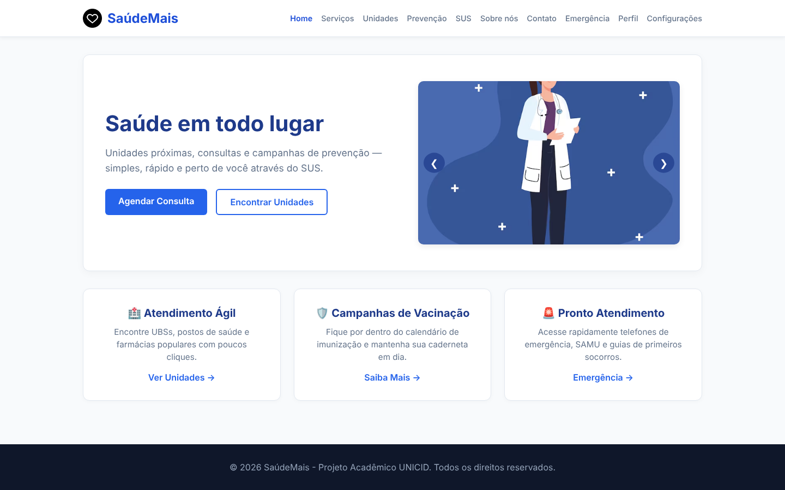
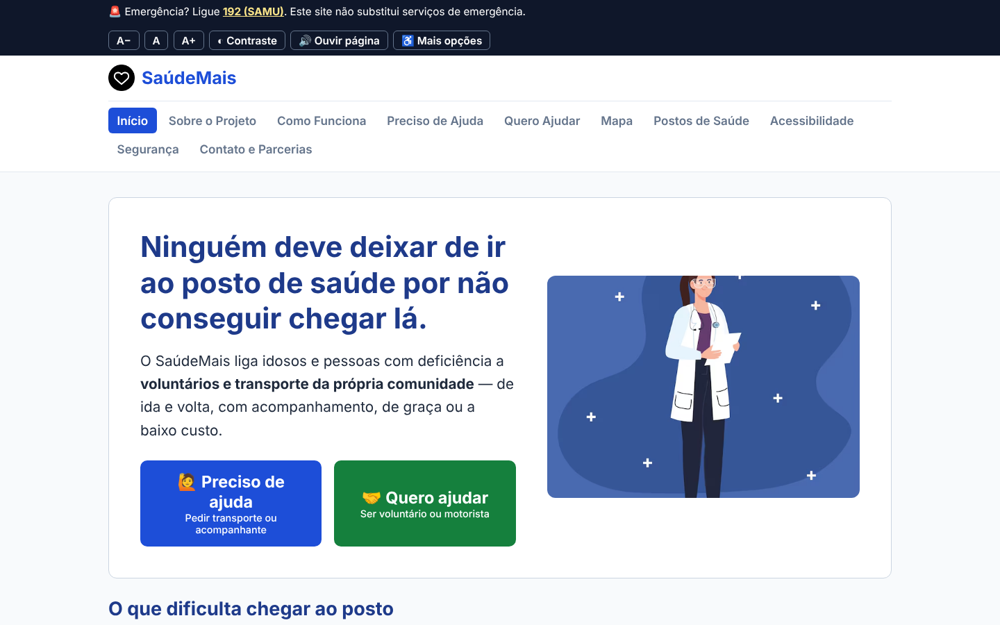
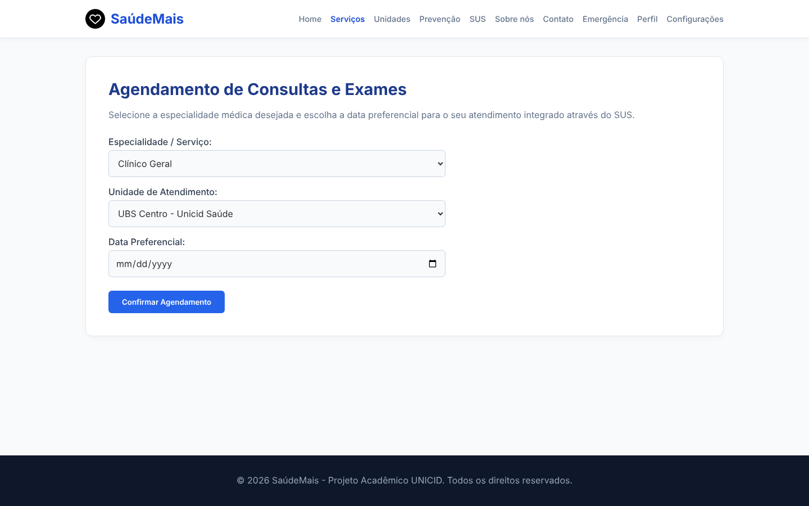
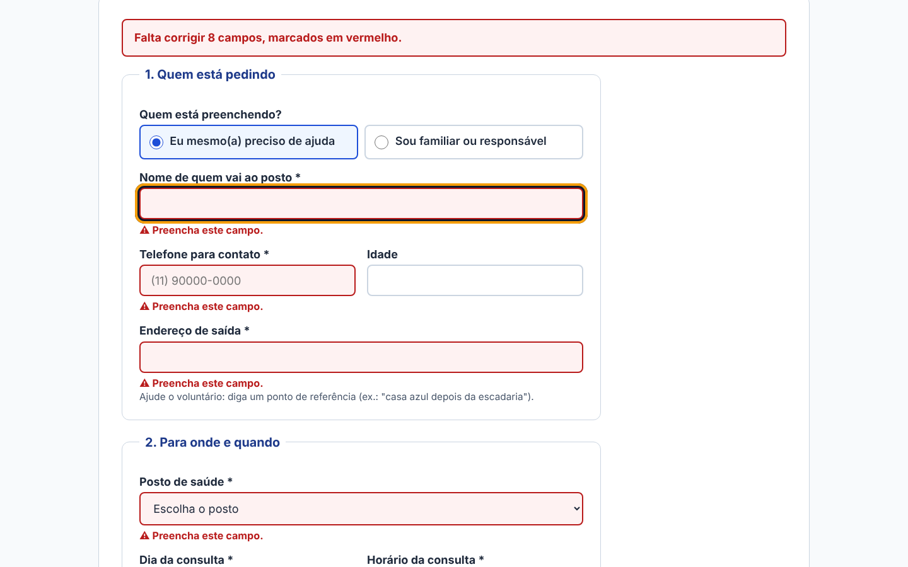

# 🔧 Melhorias desde o MVP (1ª entrega)

O professor não fez apontamentos na 1ª entrega e pediu para listarmos o que melhoramos com mais atenção.

- **MVP (1ª entrega), ainda no ar:** https://saudemais.up.railway.app/index.html
- **Versão final:** https://app-4173dfaf98f69675.up.railway.app/index.html

Os prints de "antes" são do MVP, a mesma versão publicada no link acima.

---

## 1. O site passou a seguir o escopo

O MVP tinha cara de portal de saúde genérico, com um botão **"Agendar Consulta"**. O próprio escopo diz que o projeto **não marca consultas**: ele ajuda idosos e PCDs a **chegar** ao posto.

| Antes (MVP) | Depois (versão final) |
|-------------|-----------------------|
|  |  |
| "Saúde em todo lugar", com os botões "Agendar Consulta" e "Encontrar Unidades" | "Ninguém deve deixar de ir ao posto…", com os botões **"Preciso de ajuda"** e **"Quero ajudar"**, como o escopo pede |

As páginas Serviços, Prevenção, SUS, Perfil e Emergência, que não estavam no escopo, deram lugar a **Como Funciona, Preciso de Ajuda, Quero Ajudar, Mapa e Segurança**, seguindo a tabela "Estrutura do Site" do README.

---

## 2. Formulário com validação em JavaScript e dados salvos

| Antes (MVP) | Depois (versão final) |
|-------------|-----------------------|
|  |  |
| Agendamento com 3 campos; confirmação com `alert()` e nenhuma validação própria | Pedido de transporte completo; mensagem de erro e borda vermelha em cada campo, resumo dos erros e foco no primeiro campo errado |

Também foram adicionados:
- **Rascunho no localStorage:** o que a pessoa digita volta quando ela recarrega a página ([print](evidencias/form-rascunho.png)).
- **Lista de pedidos enviados** neste aparelho.
- **Telefone e idade só com números**, com máscara `(11) 98765-4321`.

---

## 3. Site inteiro usável só com o teclado

| Antes (MVP) | Depois (versão final) |
|-------------|-----------------------|
| O formulário de agendamento tirava o contorno de foco dos campos (`outline: none`) | Contorno amarelo e preto em todo item focado ([print](evidencias/teclado-foco.png)) |
| Sem atalho para pular o menu | "Pular para o conteúdo" no primeiro Tab |
| Menu com 10 links soltos | Menu que vira botão no celular e fecha com Esc |

---

## 4. Funcionalidades de ONG

| Antes (MVP) | Depois (versão final) |
|-------------|-----------------------|
| Sem notícias | Notícias com filtro por assunto e botão "Ler mais" ([print](evidencias/noticias.png)) |
| Sem área de apoio | Área de doações com botão "Copiar chave PIX" ([print](evidencias/doacoes.png)) |
| Sem multimídia | Vídeo explicativo e mapa (iframe do OpenStreetMap) |

---

## 5. Código validado e site publicado

| Antes (MVP) | Depois (versão final) |
|-------------|-----------------------|
| Script do VLibras carregado duas vezes em cada página | Carregado uma vez; a caixa dele é criada pelo JavaScript |
| Sem teste no validador | **0 erros no W3C** nas 10 páginas |
| Site publicado com a versão antiga | Deploy automático no Railway, com HTTPS, a cada commit |
